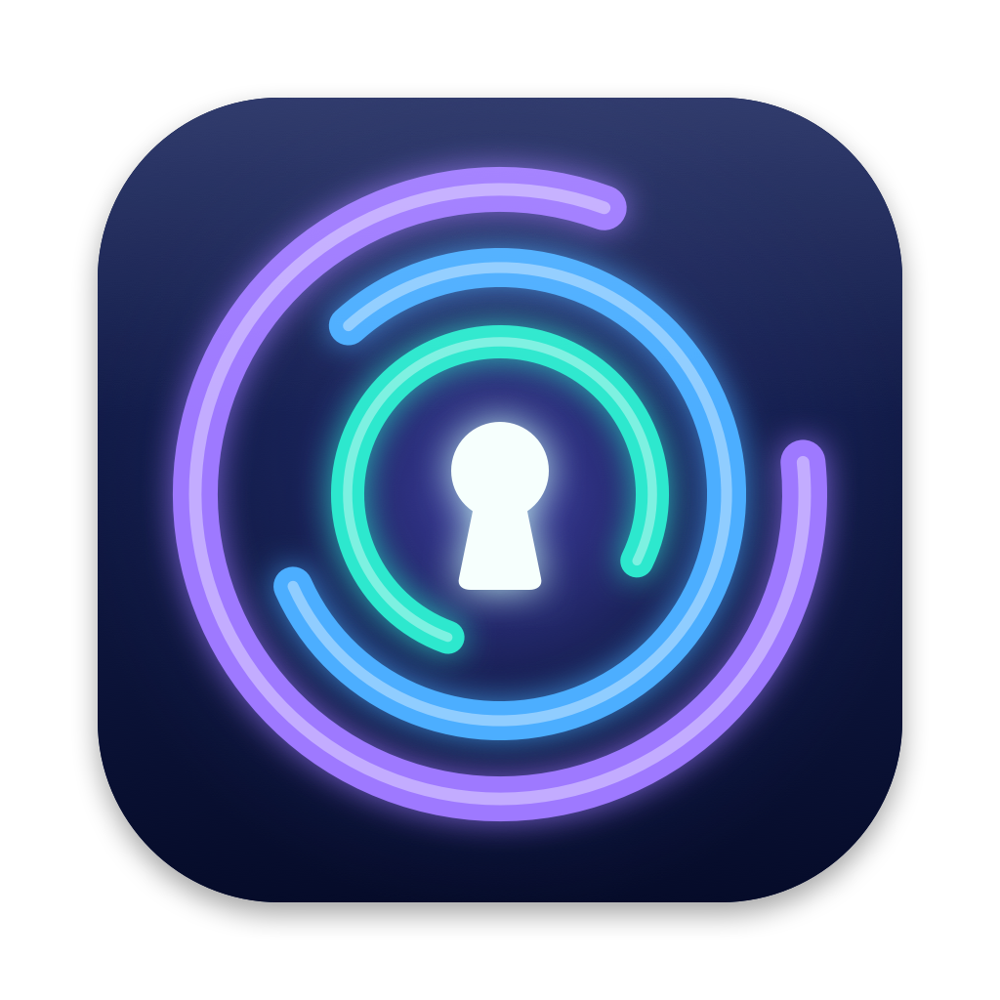
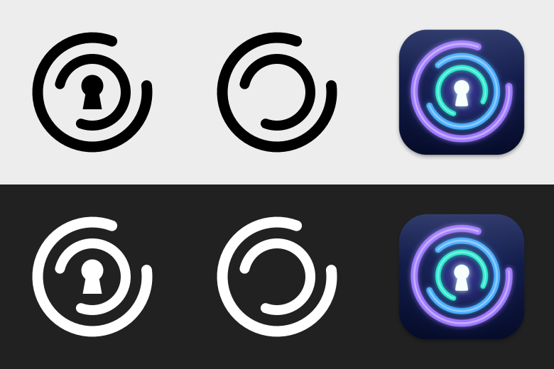

<div align="center">



# Stay Private

**A free, one-click WireGuard VPN for your Mac's menu bar.**

[](https://github.com/Puvistyne-tech/stay-private-vpn/releases/latest)
[](https://github.com/Puvistyne-tech/stay-private-vpn/actions/workflows/release.yml)

[](LICENSE)

</div>

Stay Private is a small menu bar app that connects your Mac to any WireGuard VPN with one click. It has no accounts, no ads, no tracking and no subscription. You bring a free WireGuard config file (the guides below show where to get one), and the app takes care of connecting, switching, DNS and a quick speed test.

- **One click** to connect or disconnect, with your current public IP and data usage in the menu.
- **Several profiles**: import one config per country or server and switch between them from the menu.
- **Speed test** built in (uses macOS's own `networkQuality` tool, so nothing extra to install).
- **Safe disconnect**: your DNS settings are saved before connecting and put back afterwards, so the internet does not "stop" when you turn the VPN off.
- **Free to build and run**: no Apple Developer account needed, because it drives the open-source WireGuard tools instead of Apple's paid VPN framework.

## Contents

- [Install](#install)
- [Get a free VPN config](#get-a-free-vpn-config)
- [Using the app](#using-the-app)
- [Troubleshooting](#troubleshooting)
- [How it works and what it sends](#how-it-works-and-what-it-sends)
- [Limits you should know about](#limits-you-should-know-about)
- [Build from source](#build-from-source)
- [Releases and versions](#releases-and-versions)
- [Uninstall](#uninstall)
- [FAQ](#faq)

## Install

You need a Mac running **macOS 13 or later** (Apple Silicon or Intel). The whole setup takes about five minutes and the Terminal is needed for one command.

### 1. Download

Get `StayPrivate-<version>.dmg` from the [latest release](https://github.com/Puvistyne-tech/stay-private-vpn/releases/latest). Open it and drag **Stay Private** onto the **Applications** folder.

### 2. Open it the first time

Stay Private is not notarized by Apple, because that costs $99 a year. macOS therefore blocks the first launch of any copy you downloaded.

**macOS 15 (Sequoia) or later**

1. Open Stay Private from Applications. macOS says it could not verify the app. Click **Done**.
2. Open **System Settings → Privacy & Security** and scroll down to the **Security** section.
3. Next to *"Stay Private" was blocked*, click **Open Anyway**, then confirm with your password or Touch ID.

**macOS 13 or 14**: right-click (or Control-click) the app in Applications, choose **Open**, then click **Open** again.

**Any version, from Terminal** (removes the "downloaded from the internet" mark):

```bash
xattr -dr com.apple.quarantine "/Applications/Stay Private.app"
```

You only do this once. A keyhole icon now appears in your menu bar.

> [!NOTE]
> If you want to be sure the download is intact, compare it with the `.sha256` file from the release: `shasum -a 256 -c StayPrivate-<version>.dmg.sha256`. Or skip the question entirely and [build it yourself](#build-from-source).

### 3. Install the WireGuard tools

Stay Private uses the standard WireGuard tools, installed through [Homebrew](https://brew.sh). If you do not have Homebrew yet, install it from [brew.sh](https://brew.sh) first.

```bash
brew install wireguard-tools
```

### 4. Install the helper

Switching a VPN on needs administrator rights. Rather than asking for your password every time, Stay Private installs one small, locked-down helper once.

Click the keyhole icon in the menu bar, then **Install helper…**, and enter your Mac password in the macOS prompt. The password goes to macOS, never to this app. Details of what gets installed are in [How it works](#how-it-works-and-what-it-sends).

### 5. Add a config and connect

Follow the next section to get a config file, then click the keyhole icon → **Import config…** → pick the file → **Connect**.

## Get a free VPN config

Stay Private connects with any standard WireGuard `.conf` file. **The config file decides the country**: each file points at one server, so to switch country you import another file. Download one per country you want and they all appear as profiles.

The menu also contains this Proton guide (**How to get a config**), in case you forget.

### Option A: Proton VPN Free (pick a country, no card needed)

Proton is an established VPN provider with a free plan. Free accounts can only use servers in a few countries, and that list changes, so check the *Server* list when you create the config.

1. Create a free account at [protonvpn.com/free-vpn](https://protonvpn.com/free-vpn) and sign in at [account.protonvpn.com](https://account.protonvpn.com).
2. Go to **Downloads**, then **WireGuard configuration** ([direct link](https://account.protonvpn.com/downloads)).
3. Type a name for the config, and for **Platform** pick macOS.
4. Leave the **VPN options** as they are. On the Free plan, VPN Accelerator is the only one available.
5. Under **Server**, pick a free server in the country you want, then click **Create**.
6. Wait a few seconds, then click **Download** to save the `.conf` file.
7. Rename the file to something short, like `canada.conf`. The profile takes its name from the file name, shortened to 12 characters. Two files whose names start the same 12 characters would overwrite each other.
8. In Stay Private, click **Import config…** and choose the file. Repeat for other countries.

Proton's own guide: [How to download WireGuard configuration files](https://protonvpn.com/support/wireguard-configurations/).

### Option B: Cloudflare WARP (fast, no account, but no country choice)

WARP always uses the nearest Cloudflare location and normally exits in your own country. It hides your IP address from websites and protects you on public Wi-Fi, but it will not make you appear to be somewhere else.

It uses the open-source [`wgcf`](https://github.com/ViRb3/wgcf) tool, an unofficial client for WARP. Registering with it means accepting [Cloudflare's WARP terms](https://www.cloudflare.com/application/terms/).

```bash
brew install wgcf
wgcf register
wgcf generate
```

This creates `wgcf-profile.conf`. Rename it to `warp.conf` and import it.

### Option C: Your own server

If you run a WireGuard server (for example a small cloud VM), export a client config from it and import that. See the [WireGuard quick start](https://www.wireguard.com/quickstart/). This gives you one fixed location of your choice and full control, but cloud providers usually ask for a card when you sign up.

### About config files

> [!WARNING]
> A config file contains a **private key**. Do not share it or post it anywhere. Once it is imported you can delete the downloaded copy, because Stay Private keeps its own copy that only the administrator account can read.

Configs containing `PreUp`, `PostUp`, `PreDown`, `PostDown` or `SaveConfig` lines are refused on purpose: those lines run commands as root. Normal configs from Proton and wgcf do not have them.

## Using the app



| Menu bar icon | Meaning |
|---|---|
| Full-colour keyhole | Connected |
| Single-colour keyhole (black or white to match the menu bar) | Not connected |
| Single-colour rings without the keyhole | Connecting, disconnecting, or the server is not answering |

| Do this | To |
|---|---|
| Click the icon, then **Connect** or **Disconnect** | Turn the VPN on or off |
| Click a profile name | Switch to it (reconnects automatically if you are connected) |
| Right-click a profile, then **Remove** | Delete the profile and its stored config |
| **Import config…** | Add a profile from a `.conf` file |
| **How to get a config** | Show the Proton guide inside the app |
| **Speed test** | Measure download, upload and latency (about 20 seconds, through the VPN when connected) |
| **Launch at login** | Start Stay Private when you log in |

**Check that it works.** Note your IP before connecting (the menu shows it, or visit a "what is my IP" site, or run `curl https://api.ipify.org`). After connecting it should be different, and the status should read **Connected**.

## Troubleshooting

| Problem | What to do |
|---|---|
| macOS will not open the app the first time | See [Open it the first time](#2-open-it-the-first-time). |
| The menu says **One-time setup** | Click **Install helper…** and enter your Mac password. The same button appears if the helper is out of date after an app update. |
| Connect says **WireGuard tools are missing** | Run `brew install wireguard-tools` in Terminal, then try again. |
| **No response** next to the profile name | The tunnel is up but the server is not answering. Because all traffic goes into the tunnel, the internet will seem down. Disconnect and try again, or pick another profile. Free servers can be busy, and a config can stop working if you revoke it in your Proton account. |
| **The internet stops working after disconnecting** | Your DNS is still pointing at the VPN. Run `sudo /usr/local/libexec/stayvpn-helper repair` with the VPN off. This should not normally happen, because the helper restores DNS itself and heals leftovers on the next check. |
| Import says the config contains a `PostUp` (or similar) line | Remove that line from the file, or get a fresh config. See [About config files](#about-config-files). |
| Import says the profile name is invalid | Rename the file using only lowercase letters, digits and `-`. |
| Connected, but the IP did not change | Make sure the status says **Connected** (not **No response**), then reload the "what is my IP" page. Some browsers keep an old connection open. |
| **Launch at login** does not stick | Keep the app in `/Applications`. macOS may also list it under **System Settings → General → Login Items**, where you can switch it on or off. |
| The speed test fails | It needs a working connection, and macOS 12 or later. Try again, or check the connection without the VPN. |

Useful checks in Terminal:

```bash
sudo /usr/local/libexec/stayvpn-helper status   # active tunnel, handshake time, data used
sudo /usr/local/libexec/stayvpn-helper list     # saved profiles
sudo /usr/local/libexec/stayvpn-helper down NAME  # disconnect a profile by hand
```

## How it works and what it sends

```
Stay Private.app (your user)  ──sudo -n──▶  /usr/local/libexec/stayvpn-helper (root)  ──▶  wg-quick / wireguard-go
```

**The helper.** The app never runs as root. It may run exactly one thing as root: the helper script, through a sudo rule that names only that file. The helper accepts a fixed list of commands (`version`, `list`, `status`, `up`, `down`, `import`, `remove`, `repair`) and checks every argument.

| What | Where |
|---|---|
| Helper (root-owned) | `/usr/local/libexec/stayvpn-helper` |
| Sudo rule for that one file | `/etc/sudoers.d/stayvpn` |
| Your configs (root-owned, mode 600) | `/etc/wireguard/sv-<profile>.conf` |
| Saved DNS settings while connected | `/var/db/stayvpn/dns.saved` |
| Last-used profile (an ordinary preference) | `defaults read local.stayprivate.app` |

**Safety rules in the helper**

- Profile names are limited to `a-z`, `0-9` and `-`, 12 characters at most, so a name cannot point at another file.
- Configs with `PreUp`, `PostUp`, `PreDown`, `PostDown` or `SaveConfig` are refused, because those would run commands as root.
- Symlinks, empty files and files over 64 KB are refused on import.
- These rules are covered by automated tests (`Tests/helper-tests.sh`) that run on every build.

**The DNS fix.** WireGuard's own script points every network service at the VPN's DNS server and restores your old settings in a background process. On macOS that restore is unreliable and can leave you without working DNS after disconnecting. The helper therefore saves your DNS settings before connecting and puts them back itself.

**What the app sends over the network.** There is no analytics, account or update check. Two things leave your Mac, apart from the VPN traffic itself:

- A request to `api.ipify.org` to show your current public IP in the menu (at launch and after each connect or disconnect).
- The speed test, which talks to Apple's `networkQuality` servers, only when you click **Speed test**.

## Limits you should know about

- **No kill switch.** If the tunnel is removed unexpectedly (for example the WireGuard process is killed), your traffic goes out over your normal connection, unprotected, and Stay Private does not block it. A tunnel whose server has gone quiet just shows **No response** and has no internet until you disconnect.
- **No automatic reconnect** after sleep or a Wi-Fi change. If the menu shows **No response** after waking your Mac, disconnect and connect again.
- **Quitting the app leaves the VPN on.** Open the app again to disconnect.
- **Not notarized.** See [Open it the first time](#2-open-it-the-first-time).
- **The helper runs Homebrew's copies of `wg-quick` and `wireguard-go` as root.** Homebrew's folder is writable by your user account, so this is as safe as running `sudo wg-quick` yourself, and no safer.
- **A VPN is not anonymity.** Your traffic is only as private as the server operator you choose. Free servers are also slower and offer fewer locations than paid ones.
- This is a personal project and has not had an independent security audit.

## Build from source

You need macOS 13 or later and Swift 5.9 or later (install the Xcode Command Line Tools with `xcode-select --install`, or use Xcode).

```bash
git clone https://github.com/Puvistyne-tech/stay-private-vpn.git
cd stay-private-vpn
```

| Command | What it does |
|---|---|
| `swift test` | Runs the unit tests |
| `./Tests/helper-tests.sh` | Runs the helper's security and file-handling tests (no root needed) |
| `./scripts/build-app.sh` | Builds `build/Stay Private.app` |
| `./scripts/build-app.sh --install` | Builds, installs to `/Applications` and launches |
| `./scripts/build-dmg.sh` | Builds `build/Stay Private.dmg` |
| `STAYPRIVATE_UNIVERSAL=1 ./scripts/build-dmg.sh` | The same, for both Apple Silicon and Intel |
| `./scripts/make-icon.sh` | Regenerates the app icon in `assets/` |

A copy you built yourself is not marked as downloaded, so it opens without the "Open Anyway" step. You can also install the helper from the project folder instead of from the app:

```bash
sudo ./scripts/install-helper.sh
```

| Path | What it is |
|---|---|
| `Sources/StayVPNCore/` | Config validation, status parsing, speed test, helper client (unit tested) |
| `Sources/StayVPN/` | The SwiftUI menu bar app |
| `helper/stayvpn-helper` | The root helper (bash) |
| `scripts/` | App bundler, DMG builder, helper installer, icon generator |
| `Tests/` | Unit tests (Swift) and the helper tests (`helper-tests.sh`) |
| `assets/` | The app icon |
| `.github/` | The build and release workflow |

The app is called Stay Private, but its internal names (the Swift targets, the helper `stayvpn-helper` and its sudo rule) still use its first name, StayVPN. Renaming them would mean reinstalling the helper for no visible change.

**Changing the helper.** Bump `VERSION` in `helper/stayvpn-helper` and `expectedVersion` in `Sources/StayVPNCore/HelperClient.swift` together (a test checks that they match). The app then shows **Install helper…** until the installed helper is updated.

## Releases and versions

Every push to `main` that changes more than documentation runs the [build workflow](.github/workflows/release.yml):

1. Runs the unit tests and the helper tests.
2. Builds a universal (Apple Silicon and Intel) app and packs it into a DMG.
3. Tags the commit `v<major>.<minor>.<n>` and publishes a [GitHub release](https://github.com/Puvistyne-tech/stay-private-vpn/releases) with `StayPrivate-<version>.dmg`, its `.sha256` checksum and automatic release notes.

The version is `<major>.<minor>` from the [`VERSION`](VERSION) file, plus `<n>`, the number of commits on `main`, so every release has a higher version than the one before. To start a new minor or major version, edit `VERSION` (for example `1.1`) and push. Pull requests run the tests only. You can also start a release by hand from the **Actions** tab (**Run workflow**).

## Uninstall

If you still have the project folder:

```bash
sudo ./scripts/install-helper.sh --uninstall --purge
```

If you installed from the DMG, the same script is inside the app:

```bash
sudo "/Applications/Stay Private.app/Contents/Resources/install-helper.sh" --uninstall --purge
```

This disconnects any tunnel and removes the helper, the sudo rule and all saved profiles (leave out `--purge` to keep the profiles). Then remove the app and its saved preference:

```bash
rm -rf "/Applications/Stay Private.app"
defaults delete local.stayprivate.app
```

## FAQ

**Is it really free?** Yes. The app is free and open source, and the VPN servers come from whichever free source you choose. Free servers are limited, but there are no fees from this project.

**Can I choose the country?** Through the config file you import: one file is one server. Proton's free plan offers a few countries. Cloudflare WARP does not let you choose.

**Does Stay Private keep logs?** No. It has no servers and collects nothing. What the VPN server operator logs is a separate question; read the policy of the provider you use.

**Why not Apple's built-in VPN framework?** It requires a paid Apple Developer account. Driving the open-source WireGuard tools is what keeps this free.

**Can I use a different VPN provider?** Yes, any provider or server that gives you a standard WireGuard `.conf` file.

---

Stay Private is not affiliated with or endorsed by Proton, Cloudflare or the WireGuard project. "WireGuard" is a registered trademark of Jason A. Donenfeld. Released under the [MIT License](LICENSE).
